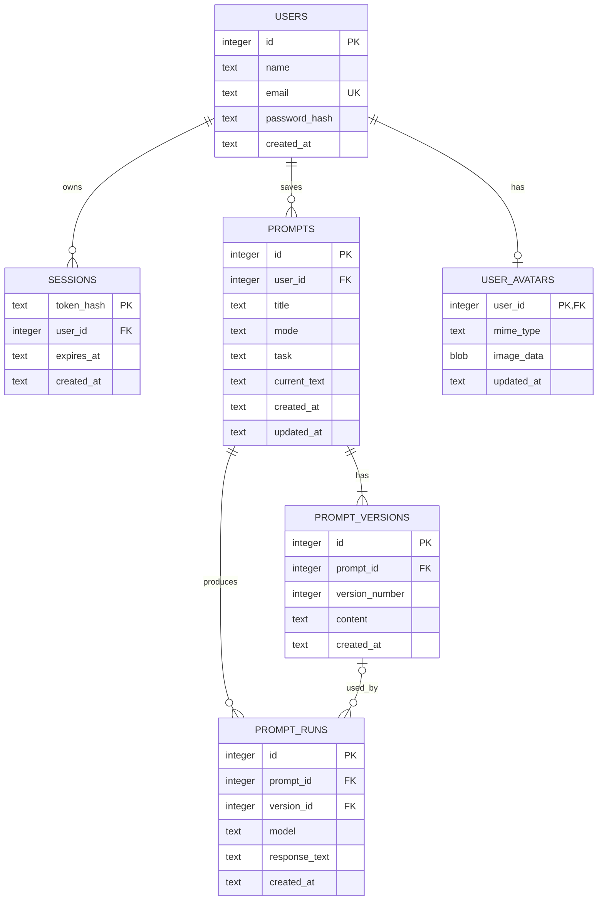

# Database design

Promptly uses SQLite with foreign keys enabled. The local database file defaults to `data/promptly.sqlite`. Set `DB_PATH` to override the location. If this project folder is synchronized by OneDrive, run one local server at a time so two SQLite writers do not compete for the same file.

## Relationships and rules

- A user owns many prompts and sessions. Deleting a user cascades to their sessions and prompts.
- Each user can store one optional profile photo; accounts without one display the first letter of their name.
- A prompt belongs to one user. Every content edit creates a new, numbered prompt version.
- An AI run records the model response and references the version that was executed. Removing a version does not erase its run record; the reference becomes null.
- Prompt reads and writes include the authenticated user ID in their database query. Knowing another prompt's numeric ID does not grant access.
- Passwords are stored only as scrypt hashes. Session tokens are random, returned in HTTP-only cookies, and stored in SQLite as SHA-256 hashes.

## Storage lifecycle

Tables and indexes are created automatically at server startup. The default database path is `./data/promptly.sqlite`. SQLite WAL files are created beside the database while it is in use; stop the app before copying the database for a manual backup.
